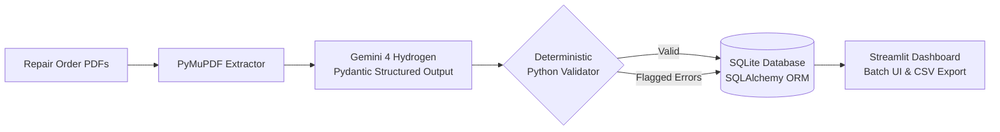

# Automated Repair Order & Invoice Validation


Takes repair orders and using AI with structured output, will extract information, validate math and output the clean records into a database.

---

## System Architecture



### Key Engineering Decisions
* **Separating AI Extraction from Deterministic Math:** The AI is explicitly instructed to extract raw printed figures verbatim (`temperature=0.0`, `ThinkingLevel.LOW`), while pure Python rules in `src/validator.py` verify line-item multiplication, subtotals, 14% Nova Scotia HST, and 17-character VIN formatting.
* **Resilient API Integration:** Wraps Gemini API calls in an exponential backoff retry loop (`src/parser.py`) to gracefully recover from transient `429` rate limits and `503` server demand spikes without dropping batch jobs.
* **Idempotent Persistence:** Uses `SQLAlchemy` with unique constraints on `ro_number` (`src/database.py`) so re-uploading or batch-processing overlapping folders skips duplicates cleanly.
* **Automated CI/CD Quality Gates:** Every push triggers a **GitHub Actions** workflow (`.github/workflows/tests.yml`) that runs the `pytest` unit test suite against edge cases—including negative core-return credits, multi-page invoices, and rounding tolerances.

---

## Tech Stack
* **Language:** Python 3.12
* **AI & Schema Enforcement:** Google GenAI SDK (`gemini-4-hydrogen`), Pydantic v2
* **PDF Processing:** PyMuPDF (`pymupdf`), FPDF2 (synthetic test data generator)
* **Database & ORM:** SQLite, SQLAlchemy 2.0
* **Frontend & Reporting:** Streamlit, Pandas
* **Testing & CI:** Pytest, GitHub Actions

---

## Quickstart

### 1. Clone & Set Up Virtual Environment
```bash
git clone https://github.com
cd automated-invoice-pipeline

python -m venv venv
# Windows PowerShell:
.\venv\Scripts\Activate.ps1
# Mac/Linux:
source venv/bin/activate

pip install -r requirements.txt
```

### 2. Configure Environment Variables
Create a `.env` file in the project root and add your Google AI Studio API key:
```env
GEMINI_API_KEY=your_api_key_here
```

### 3. Run the Interactive Dashboard
```bash
streamlit run app.py
```
Upload the 8 synthetic test PDFs located in `data/sample_pdfs/` (which include intentional line-item math bugs, HST miscalculations, invalid VINs, negative core credits, and multi-page repair orders) to see the pipeline audit them in real time.

### 4. Run Automated Unit Tests
```bash
pytest -v
```

---

## 📂 Project Structure

```text
automated-invoice-pipeline/
├── .github/workflows/
│   └── tests.yml            # GitHub Actions CI pipeline
├── data/
│   └── sample_pdfs/         # 8 synthetic repair order PDFs (valid + intentional edge-case bugs)
├── src/
│   ├── extractor.py         # Multi-page PDF text extraction via PyMuPDF
│   ├── parser.py            # Pydantic schemas + Gemini 4 Hydrogen structured extraction with retries
│   ├── validator.py         # Deterministic math, tax, and VIN business-rule engine
│   └── database.py          # SQLAlchemy models, SQLite storage, and duplicate protection
├── tests/
│   └── test_validator.py    # Pytest unit test suite
├── app.py                   # Streamlit batch-upload dashboard & CSV exporter
├── generate_samples.py      # Script to generate synthetic repair order PDFs
├── pytest.ini               # Pytest configuration
└── requirements.txt
```